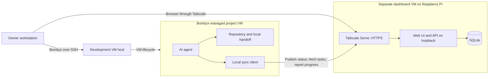

# Silkboard Architecture

Date: 2026-10-13

Status: Proposed; not implemented. The [roadmap](roadmap.md) takes precedence
for delivery priorities and the rustbase technology foundation.

## 1. Purpose and requirements

Provide a private overview of multiple AI-assisted software projects so the owner
can return after days or weeks and understand completed work, current focus,
blockers, and the exact next action. Preserve session handoffs and show how recent
information is. Let the owner add and prioritize tasks remotely.

Development happens inside Bombyx-managed agent VMs. Those environments initiate
connections to publish status and fetch tasks. The dashboard has no GitHub
credentials, repository mounts, or direct access to development environments.

Run the dashboard in a dedicated VM on the owner's Raspberry Pi. Serve the UI and
API over HTTPS through Tailscale. The initial service does not execute code,
start agents, provision VMs, fetch repository contents, or deploy projects.

## 2. Components and trust boundaries

The development host's physical location is independent of the dashboard's Pi.
If they share hardware, use separate guests and network boundaries. The
hypervisor host remains trusted because it can access guest disks.

Use one application serving the UI and `/api/v1` from the same origin. Store data
in SQLite on persistent local VM storage. A sync client in each development VM
handles credentials, polling, uploads, and retries. No broker is required.

All application connections originate from clients. API responses still carry
information into development environments: limiting network reachability does
not remove the influence of malicious task content.

## 3. Authority and information ownership

| Information | Authoritative location |
|---|---|
| Source code, tests, and Git state | Project repository inside the guest |
| Architecture decisions and domain knowledge | Project documentation |
| Latest session handoff | Project-local structured file |
| Published status and handoff history | Dashboard snapshots |
| Tasks, priority, acceptance criteria, task state | Dashboard database |
| Agent execution permissions | Owner-controlled development configuration |
| VM lifecycle and host configuration | Bombyx and operator configuration |

Generate a readable `docs/state.md` from the local structured handoff if useful.
Publishing creates a snapshot, rather than requiring two independently maintained
summaries. Only explicitly selected summaries leave the development environment.
Never upload credentials, source archives, or unrestricted logs automatically.

Task descriptions cannot override repository policies, execution permissions, or
architectural decisions. Creating a task does not authorize sensitive execution.

## 4. Data model

**Project:** stable ID, name, description, lifecycle (`idea`, `active`, `paused`,
`archived`), credential associations, and latest status. The owner controls
lifecycle; old information is stale rather than automatically paused.

**Status snapshot:** schema version, project ID, runtime ID and generation,
producer ID and sequence, observation time, server receipt time, current focus,
completed work, blockers, exact next action, relevant paths, verification summary,
and optional branch/commit reference. Paths are inert text, not server filesystem
instructions. Distinguish passing, failing, and unrun checks.

Initially designate one current-status publisher per project. Other agents can
publish handoffs and progress without replacing its snapshot. Producer sequences
order updates within a runtime generation; they do not establish a global order
between unrelated producers.

**Session handoff:** session ID, project/runtime/producer identity, start/end
times, completed work, unfinished work, exact resume action, relevant references,
and verification results.

**Task:** ID, project ID, title, description, acceptance criteria, priority,
revision, timestamps, optional dependencies, and state (`todo`, `in_progress`,
`blocked`, `done`, `cancelled`). Include claim holder/expiry and completion evidence.
Distinguish agent-reported completion from owner review.

**Runtime:** server-registered guest identity, generation, permitted project and
scopes, active/retired state, and associated credentials. Reset or replacement
requires trusted owner-side registration of a new generation.

**Credential:** actor/runtime/project association, scopes, hashed random token,
expiry, and revocation state. Show plaintext only at issuance.

**Audit event:** server time, authenticated actor, project, action, entity ID,
result, and request ID. Exclude tokens and unnecessary sensitive content.

## 5. API contract

All routes require application authentication and resource authorization.

| Method and route | Purpose | Caller |
|---|---|---|
| `GET /api/v1/projects` | List projects | Owner |
| `POST /api/v1/projects` | Register project | Owner |
| `GET /api/v1/projects/{id}/status` | Read current snapshot | Owner or project client |
| `PUT /api/v1/projects/{id}/status` | Publish snapshot | Designated publisher |
| `POST /api/v1/projects/{id}/handoffs` | Publish handoff | Project client |
| `GET /api/v1/projects/{id}/tasks?cursor=...` | Fetch task changes | Owner or project client |
| `POST /api/v1/projects/{id}/tasks` | Create task | Owner |
| `PATCH /api/v1/projects/{id}/tasks/{task_id}` | Edit definition or priority | Owner |
| `POST /api/v1/projects/{id}/tasks/{task_id}/claim` | Atomically claim work | Project client |
| `POST /api/v1/projects/{id}/tasks/{task_id}/progress` | Report state and evidence | Claim holder |
| `POST /api/v1/projects/{id}/tasks/{task_id}/release` | Release claim | Claim holder or owner |

Check both the credential's project and each entity's stored project; caller-
supplied IDs never grant access. Bind progress to the current runtime, claim, and
task revision. Clients cannot edit acceptance criteria or grant permissions.

Use idempotency keys for create/claim/handoff/progress requests. Scope keys to actor
and operation; identical retries return the original result, while reuse with
different content fails. Use conditional revisions for task updates and reject
stale writes rather than silently overwriting owner edits.

Polling uses opaque server cursors, pagination, and cancellation/deletion records.
Initial sync returns a consistent full view. Expired cursors require full resync.
Save a cursor only after applying its changes locally.

Claims use server time and short renewable leases with atomic claim/renewal.
Expired holders cannot report progress under the old lease. Agents stop leased
work when they cannot renew. Coordination does not control agents that ignore it.

## 6. Workflows and failure behavior

### Start or resume

1. Read the local handoff, repository instructions, and Git working state.
2. Establish an active runtime generation and fetch task changes.
3. Reconcile local work and owner edits.
4. Validate the selected task against local permissions and claim it.

### Work and stop

1. Renew claims and publish meaningful progress.
2. Record verification accurately, including failures and unrun checks.
3. Write the local handoff before depending on network upload.
4. Queue and publish status, handoff, and progress with idempotency keys.
5. Complete or release the claim as appropriate.

Use a durable bounded local upload queue with exponential retries. Reject older
producer sequences so delayed requests cannot replace current status. If a task's
definition changes, pause and reconcile before continuing.

An outage preserves local handoffs and queued updates while the guest disk
survives. New tasks remain unavailable. Stop leased work when renewal cannot be
guaranteed; unrelated local work follows existing local policies.

Show observation and receipt times, configurable staleness thresholds, queue
failures, and the last acknowledged snapshot. Abrupt termination cannot guarantee
a final upload.

## 7. Bombyx provisioning and VM lifecycle

Bombyx composes SSH, Vagrant, and libvirt. Operator configuration lives outside
project repositories, and the guest clones its repository. Preserve that boundary:
the dashboard holds no VM-host SSH keys, Bombyx control credentials, or hypervisor
access. See the [Bombyx model](https://github.com/breki/bombyx#model).

Provision participating guests with the sync client, fixed dashboard endpoint,
stable project ID, runtime identity, project-scoped token, and approved network
connectivity. The operator sets the binding; repository content and task text
cannot redirect credential delivery or choose another project.

Bombyx supports secret transfer using `env_file`; plain `[env]` settings appear in
the generated Vagrantfile. Use an appropriate secret delivery path for tokens.
Do not supply reusable privileged enrollment or dashboard administration secrets
to guests. See [Bombyx configuration](https://github.com/breki/bombyx#configure).

Install Tailscale inside each participating guest as the proposed connectivity
model. Enrollment identities must have narrowly limited grants. The concrete
bootstrap/enrollment procedure remains an implementation decision.

### Persistent and scratch guests

| Guest | Dashboard access |
|---|---|
| Persistent project VM | Read its tasks, publish handoffs, claim and report work |
| Scratch VM | None by default |
| Scratch VM requiring reporting | Short-lived access to one assigned task |

Scratch guests must not overwrite project status or read unrelated task history.
See [Bombyx lifecycles](https://github.com/breki/bombyx#use).

### Reset and replacement

The project ID survives VM replacement. Runtime identity/generation does not.
Trusted owner-side integration retires the previous generation and registers the
new one. A guest cannot reactivate a retired credential or choose its generation.
After reset, reconcile task revisions and acquire fresh claims before work.
Server validation rejects old queues restored from snapshots.

Snapshots can retain secrets. Revocation is enforced by the dashboard, so a
restored token remains invalid. Reconcile restored Tailscale identities with the
chosen enrollment procedure. Treat guest credentials as accessible to guest code,
including privileged agents; file modes cannot isolate them from guest root.
See [Bombyx trust boundaries](https://github.com/breki/bombyx/blob/main/docs/trust-boundary.md).

### Preserve work before destructive operations

1. Preserve intended code changes through an authorized push or export.
2. Publish the handoff and confirm acknowledgment of required updates.
3. Release claims before reset, reprovisioning that changes the working state,
   destruction, or scratch discard.

If publication fails, export the handoff through an owner-controlled path before
discarding the guest. A queue on a destroyed disk cannot recover. This lifecycle
integration is proposed work, not an existing Bombyx dashboard feature.

## 8. Network and HTTPS

Install Tailscale inside the dashboard VM. Use Serve to terminate HTTPS and proxy
to the app bound to `127.0.0.1`. UI and API share one private HTTPS origin. Enable
tailnet HTTPS certificates; Serve provisions certificates automatically.
See [Tailscale Serve](https://tailscale.com/docs/features/tailscale-serve).

Do not enable Funnel or router port forwarding. Remote clients need authorized
tailnet connectivity. Grant owner devices and approved development nodes TCP 443
access; limit administration to designated owner devices. Remove broad grants
that undermine isolation and review the complete additive policy.
See [Tailscale grants](https://tailscale.com/docs/reference/syntax/grants).

Enforce separate host/hypervisor firewall rules for ordinary LAN and guest bridge
traffic. Tailscale policy alone does not block LAN access. Deny guest-initiated
connections to host management, sibling services, other guests, and development
networks except explicit dashboard/infrastructure destinations. Allow necessary
response traffic, DNS, time, updates, Tailscale, certificates, and backup traffic.
Test IPv4 and IPv6 paths on the selected network topology.

Do not assume Bombyx automatically installs these controls: its trust-boundary
document describes host-network isolation as unverified/not loaded in the
documented setup. Verify actual deployed rules.

Use a neutral dashboard hostname because certificate names appear in public
certificate-transparency logs. The service remains private.
See [Tailscale HTTPS](https://tailscale.com/docs/how-to/set-up-https-certificates).

## 9. Authentication and malicious content

Tailscale controls reachability. The app independently controls data access.

Use a dedicated owner account with secure session cookies, a modern password
hash, login rate limiting, CSRF protection, and a recovery procedure. Tailnet
membership is not administrator authentication.

Issue distinct random client tokens scoped to runtime/project and operations:
`status:write`, `handoffs:write`, `tasks:read`, and `tasks:progress`. Only the
current publisher gets `status:write`. Support expiry, revocation, and rotation.
Store client tokens outside repositories, prompts, URLs, and logs; the sync client
attaches them. Unrestricted agents remain within their guest's credential trust
boundary.

A compromised dashboard can manipulate tasks even without repository access.
Keep enforceable execution permissions outside the dashboard and, where the
agent has guest root, outside the guest. Local approval policies must not be
replaceable by dashboard fields or task text. Bind sensitive approvals to a
concrete action and current task revision. Owner edits invalidate approval for
changed actions.

The sync client never executes task-supplied commands or changes its endpoint from
task content. Disable cross-origin credential redirects. Destructive actions,
production deployments, and sensitive access follow owner-controlled policies.

Escape output, disable raw HTML and active Markdown content, and use a restrictive
content-security policy. Initially disable attachments, URL previews, arbitrary
URL fetching, server file-path access, executable hooks, and uploaded code.
Bound payload sizes, field lengths, polling rates, and retained history.

## 10. Deployment, backups, and limits

Confirm the Pi model, host OS, resources, and ARM64 virtualization support before
selecting a hypervisor. Container deployment needs an explicit decision to accept
a shared host kernel.

Use a dedicated disk, isolated network, and an unprivileged application service.
Restrict writable directories. Expose no Docker socket, host mounts, SSH keys, or
hypervisor controls. Keep Tailscale identity files inaccessible to the app.

Use SQLite transactions, foreign keys, schema migrations, and a busy timeout on
local VM storage. The application is based on the rustbase Rust/Axum and
Svelte/Vite template. Revisit storage if measured needs outgrow it.

Back up through SQLite's supported online backup mechanism or a consistent
snapshot, including journal state where needed. Encrypt backups and keep a copy
off the Pi through an explicit destination or owner-controlled pull. Test restore
into isolation. Define acceptable data loss, frequency, and retention.

After restoration, expire claims and reconcile task revisions. Rotate credentials
if restored revocation state is uncertain. Keep a documented VM-console or
restricted administration recovery path.

A compromised dashboard can expose and modify its stored coordination data. Host
or hypervisor compromise can affect guests. This design limits reach and authority;
it does not make agents immune to plausible malicious instructions.

## 11. Acceptance checks

1. Remote UI/API access works through private HTTPS; public and unauthorized
   tailnet access fails.
2. Guest-to-host, guest-to-guest, and dashboard-to-development initiated
   connections fail over both LAN and Tailscale, including IPv6.
3. Project A credentials cannot read or mutate project B, including mixed IDs.
4. Expired/revoked tokens fail; browser mutations enforce CSRF protection.
5. Retries are idempotent; delayed snapshots and stale task revisions fail.
6. Concurrent claims produce one holder; expiry and edits force reconciliation.
7. Outages preserve handoffs and queue state; reconnection converges safely.
8. Malicious Markdown renders inert; task commands cannot bypass permissions.
9. Reset guests cannot publish under retired generations; restored revoked
   credentials remain rejected.
10. Scratch guests cannot access unrelated tasks or replace project status.
11. Destructive VM operations preserve required handoffs and intended code changes.
12. Backups restore successfully with leases and credentials reconciled.
13. The dashboard cannot invoke Bombyx or administer the development host.

## 12. Roadmap and open decisions

The [project roadmap](roadmap.md) defines the general milestones and their
completion criteria. It replaces the original implementation milestone list.

Resolve the Pi/hypervisor platform, guest enrollment, trusted runtime
registration, enforcement of agent permissions, backup objectives, and retention
settings during implementation. Do not treat isolation or recovery as complete
until the corresponding acceptance checks pass.
