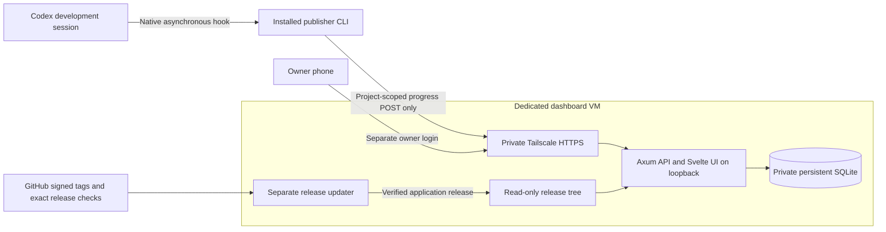

# Silkboard architecture

Updated 2026-10-18 for the agreed publish-only agent progress milestone.
The [roadmap](roadmap.md) controls delivery scope. This replaces the original
proposal's task fetching, claims, handoff uploads and durable sync queue;
those capabilities are not part of the agreed milestone or implemented API.

## Purpose and delivery status

Show short observations from development agents, grouped by project and native
session, so the owner can read independent activity and history on a phone.
GitHub remains authoritative for tasks, priorities and acceptance criteria.
A progress message is an observation, not evidence that work passed validation.

Production currently runs the minimal `v0.2.2` status page in a dedicated
Debian ARM64 VM on malina. Signed exact-revision upgrades and rollback/retry
are verified; reboot and pending-check evidence remain in the roadmap.
The progress, authentication and client features below are implemented and
locally verified, but their production activation and real Codex/phone
acceptance remain [#39](https://github.com/breki/silkboard/issues/39).

## Components and connections

The publisher runs on the current development setup first. It is a standalone
Rust executable with no target Rust/Cargo requirement. Native Codex hooks send
bounded best-effort observations; there is no daemon, background service,
durable outgoing queue or automatic delivery retry. Missing credentials,
outages and timeouts may lose observations without blocking development.
Claude integration is separate #43. Bombyx migration is independent work.

The unprivileged dashboard serves built frontend assets and same-origin API
routes from one loopback listener behind guest Tailscale Serve. SQLite lives
outside release/static directories. The root-owned updater has its own
GitHub credential, trust file and state; the dashboard cannot read them.

## Authority and data ownership

| Information or capability | Authority |
| --- | --- |
| Source, Git state, tests and local handoffs | Development repository |
| Tasks, priority and acceptance | GitHub issues and owner instructions |
| Progress observations and received history | Dashboard SQLite database |
| Owner login and token administration | Separate owner browser session |
| Publishing | One project-scoped installation credential |
| Agent execution permissions | Owner-controlled local agent configuration |
| VM lifecycle | Bombyx/operator, never the dashboard |
| Release admission/activation | Independently installed updater and operator policy |

Agents never read dashboard content, receive tasks from it or execute commands
from message fields. The dashboard holds no development-repository credentials,
repository mounts, host-control socket or development SSH keys. Dashboard
content cannot grant execution permission. Even a publisher controlling its
entire project cannot read the owner feed or administer credentials.
Host/tool/session labels are descriptive, not cryptographic attestation.
A compromised publisher can submit misleading observations within its project.

## Implemented storage and API

The [ingestion contract](progress-ingestion.md) owns exact fields and validation.
Projects have stable lowercase slugs. Credentials have per-project unique
installation labels, SHA-256 token hashes and durable revocation state. Labels
remain reserved after revocation. Raw random 256-bit tokens appear only at
issuance and are installed privately on the publishing machine.

Session identity is `(project, hostname, tool, session_id, subagent_id)`.
Parent identity is retained for children; readable names do not replace keys.
Events preserve message text, event ID, sequence and receipt time. Idempotent
replay does not duplicate progress; conflicting IDs/sequences or changed parent
metadata fail. Higher sequence determines the latest message within one
session; separate sessions have independent sequences and histories.

- `POST /api/projects/{project}/progress` accepts a publisher bearer token,
  never an owner cookie alone. Before owner initialization it returns 503.
- `/api/auth/setup` handles one-time owner registration using a provisioner
  link; `/api/auth/login` creates a separate owner browser session.
- `/api/owner` contains guarded project/session/history reads, credential
  listing/issuance/revocation, session inspection and logout. Publishers cannot
  use it, including by presenting their token as an owner cookie.
- `/health` and `/api/status` expose only health/build identity for the updater.
  There is no task, command, repository, handoff or VM-control API.

See [owner authentication](owner-login.md), [owner feed](owner-feed.md),
[first-owner setup](owner-setup.md) and [token management](publisher-tokens.md)
for exact routes, cookie/CSRF rules, private disclosure and recovery semantics.

## Client and Codex integration

The [installed publisher](publishing-cli.md) reads operator-controlled private
configuration/token files outside the checkout. Its endpoint/project come from
that configuration, never native hook input or dashboard content. It verifies
HTTPS, disallows redirects/proxies and bounds network work to three seconds.
Only counters and parent bindings persist locally, not outgoing message bodies.
Do not restore old counters while continuing the same native session identity.

[Codex reporting](codex-publishing.md) observes completed turns and child-agent
starts/completions through native asynchronous hooks. It preserves native
identity and publishes a bounded first sentence or a short lifecycle fallback.
It never reads transcript paths, prompts, source files or tool logs. The hook
returns no instructions or execution permission. Existing validation and Git
summary hooks remain separate, and user hook trust still requires review.

## Network and untrusted content

Tailscale controls private HTTPS reachability; application authentication
controls data. Tailnet membership does not confer owner access. Keep Serve
on the approved tailnet hostname, with no Funnel or router port forwarding.
The app binds loopback. Neither proxy headers nor request input choose the
configured trusted owner origin. Owner mutations require exact Origin/CSRF;
setup uses a one-time non-ambient credential and same-origin custom header.

UI rendering escapes message/label text and uses no raw HTML. Private owner
responses use no-store, framing denial, no-referrer and same-origin content
policy. There are no attachments, previews, arbitrary URL fetches or executable
message fields. Payload/field lengths, database worker admission and owner
password attempts are bounded. History has no automatic retention policy yet.
Do not add body logging or analytics that records passwords or token responses.

Do not infer complete host/guest network isolation from Tailscale or libvirt.
Host firewall, additive tailnet policy, IPv4/IPv6 and dashboard-to-development
reachability need their own observed evidence. The hypervisor and guest root
remain trusted; guest file modes cannot isolate credentials from guest root.

## Persistence, releases and recovery

The opt-in [application data configuration](application-data.md) gives the
service only its private state directory in addition to private temporary
storage. Releases remain read-only; updater/download/build state stays
inaccessible. Application upgrades replace release paths, not application data.
The drop-in is an operator installation, not a candidate release script.

Schema 3 holds progress, owner password/session hashes and setup state. Newer
schemas are refused. Backup uses a consistent SQLite snapshot including WAL;
restore writes a new path and revokes restored publisher tokens, browser
sessions and pending setup links while retaining password/history. Reissue
installation credentials after restore. A backup can contain sensitive messages
and password hashes; protect it, transfer it privately and test isolated restore.

The [rollout procedure](dogfood-rollout.md) separates reviewed preparation,
release publication, service configuration, private setup/token delivery and
live acceptance. Scheduled backup frequency, retention, off-machine destination
and acceptable data loss are owner decisions, not an implied new service.
Future schema changes need a compatible recovery plan before automatic release
publication; a symlink rollback alone cannot reverse a database migration.
Local process/snapshot tests do not establish production survival or restore.

## Verification still required

Initial live acceptance must record exact application/integration versions,
persistent state after restart/upgrade, an isolated restore, automatic reports
from real independent Codex sessions, owner phone history and unauthorized
read rejection. Preserve updater credentials/privileges and unrelated services.
Issue #39 remains open until that evidence exists. Scope after milestone 2,
Claude integration and the independent milestone-1 recovery gaps remain as
recorded in the roadmap; this document grants no new deployment authority.
