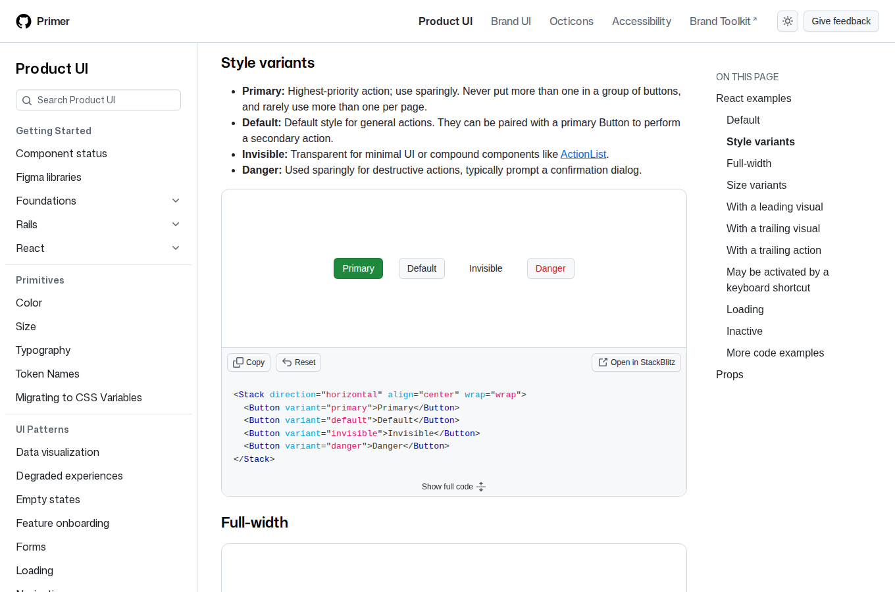
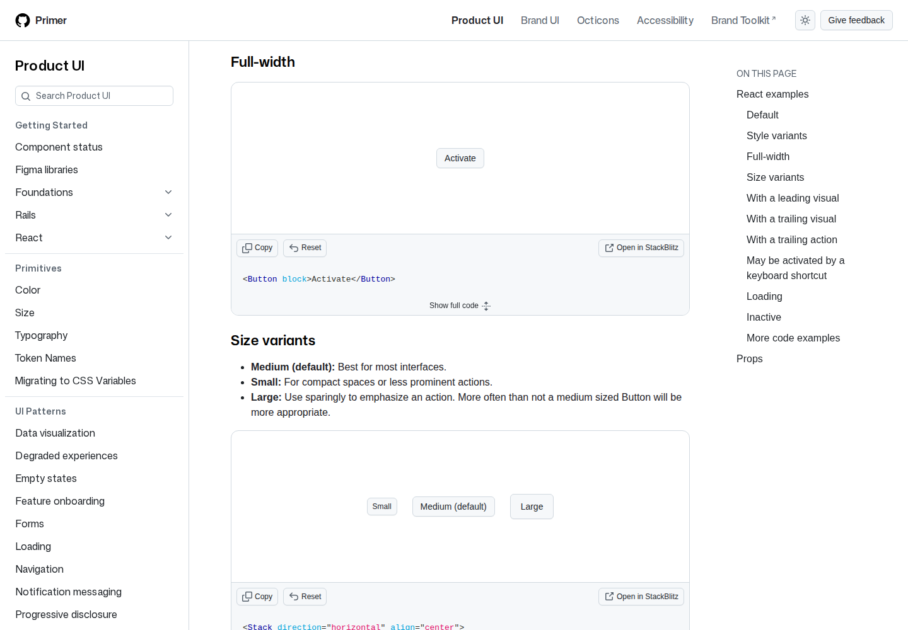
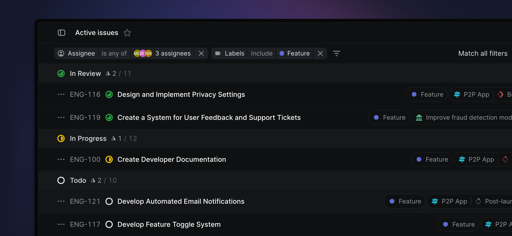
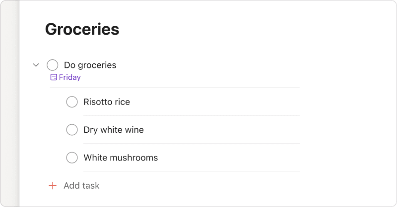
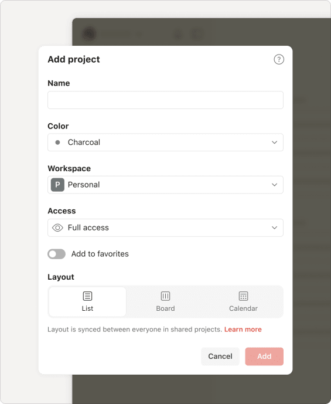

# Silkboard control style study

Requested by the owner on 2026-10-26: research comparable products, explain
why Silkboard's buttons feel too large/heavy, and put a proposal with
reference screenshots and mockups in a UI issue. This branch contains design
artifacts only. Nothing here changes the application or selects a final style.

The recommendation is **quiet neutral controls with a restrained green primary
action**. Keep Silkboard's recognizable green rather than copying another
product's brand. Separate action buttons, destination links, navigation tabs
and noninteractive status badges. These proposals also illustrate the owner's
separately requested main-agent cards (#120) and visible Todos navigation
(#121); those issues remain authoritative for their behavior.

## Reference evidence

All references were inspected on 2026-10-26. Vendor reference images are
examples from public official documentation, not our logged-in accounts.
The images remain the property of their respective publishers and are included
for attributed comparative design review, not as distributable app assets.

| Reference                                                                                                                                                                                                   | Why it is comparable                                | Useful lesson                                                                                  | Limit of the comparison                                                                      |
| ----------------------------------------------------------------------------------------------------------------------------------------------------------------------------------------------------------- | --------------------------------------------------- | ---------------------------------------------------------------------------------------------- | -------------------------------------------------------------------------------------------- |
| [GitHub Primer buttons](https://primer.style/product/components/button/)                                                                                                                                    | Developer work lists, controls and workflow actions | Separate primary, neutral, invisible and destructive actions; support deliberate size variants | Desktop density is not a mobile touch-target specification                                   |
| [Linear filters](https://linear.app/docs/filters)                                                                                                                                                           | Issues, status and filtered activity                | Quiet toolbars and compact filter affordances keep content prominent                           | A wide issue table should not be copied onto a narrow phone                                  |
| [Todoist list layout](https://www.todoist.com/help/todoist/features/use-the-list-layout-in-todoist-AMAhHMVRH) and [subtasks](https://www.todoist.com/help/todoist/features/use-sub-tasks-in-todoist-kMamDo) | Editable hierarchical checklists                    | Checkbox/text hierarchy, a distinct Add action and secondary contextual actions                | Do not import its task behavior or change Silkboard's independent checkboxes/child promotion |

### GitHub Primer — real documentation captures





The live desktop demo measured 28 px Small, 32 px Medium and 40 px Large at
capture time. These are measured examples, not a promise that every GitHub
control uses those values. The documentation recommends primary actions
sparingly and choosing sizes according to context.

### Linear — official product screenshot



Source image:
[official Linear asset](https://webassets.linear.app/images/ornj730p/production/26e1e266d76606fad8972baf4b57ed364aa2e4c1-2438x1126.png).
This demonstrates filter and status hierarchy; it is a desktop reference.

### Todoist — official documentation examples





The dialog example includes a disabled Add state. It is a hierarchy reference,
not the proposed Silkboard color palette. Source image URLs and observations
are retained in [reference observations](reference-observations.json).

## Current Silkboard diagnosis

The current shared [app styles](../../../frontend/src/app.css) set inherited
button typography, a 2.75 rem minimum height, roughly 0.55 rem vertical padding,
a visible border and filled control background. At the default 16 px root,
that is a 44 px minimum before text, padding and borders determine final size.
This is a source-based diagnosis, not a production screenshot or usability study.

Repeated secondary buttons can consequently compete visually with the content.
Reducing every hit area would sacrifice mobile usability. The proposal instead
reduces visual weight and differentiates roles, with a denser desktop size and
generous nonoverlapping touch targets on phones.

## Mockups

These are Chromium-rendered HTML/CSS concepts with fictional data. They are
not AI-generated images or implemented application behavior. The left side of
the control board reconstructs the shared base button CSS; it is explicitly
not a screenshot of a current application page. Screens do not demonstrate
complete accessibility, API integration, persistence or working menus.

- [Control hierarchy, light](proposal-controls-light.png)
- [Control hierarchy, dark](proposal-controls-dark.png)
- [Agents, desktop](proposal-agents-desktop.png)
- [Agents, 320 px phone](proposal-agents-mobile.png)
- [Todos, 320 px phone](proposal-todos-mobile.png)
- [Editable static source](proposal.html)

### Proposed control tokens

| Role                      | Visual treatment                            | Proposed size/behavior                                            |
| ------------------------- | ------------------------------------------- | ----------------------------------------------------------------- |
| Primary commit action     | Solid existing green                        | Usually one per related action group                              |
| Secondary action          | Neutral surface and a thin visible border   | 32 px desktop face; 13–14 px label                                |
| Tertiary action           | Quiet text/icon treatment                   | Still discoverable with keyboard and touch                        |
| Destination               | Underlined text link where appropriate      | Existing route and exact identity preserved                       |
| Status                    | Noninteractive badge                        | Text/symbol as well as color                                      |
| Phone control             | Compact painted face inside a larger target | At least 44 by 44 px nonoverlapping target; primary may be larger |
| Focus/loading/destructive | Distinct labeled states                     | No color-only meaning or changed deletion semantics               |

The mobile screenshots keep all four primary pages visible and show main
agents as cards. Todos Edit and Add child remain visible. Moving Delete into
a labeled More menu is a **proposal to review**, not an agreed behavior change;
confirmation must continue to explain promotion of child todos.

[WCAG 2.2 target-size guidance](https://www.w3.org/WAI/WCAG22/Understanding/target-size-minimum.html)
sets a 24 by 24 CSS pixel AA minimum with listed exceptions. Our proposed
44 px phone target is a stricter project design choice, not a claim that
WCAG AA mandates 44 px. Text contrast, focus, zoom, screen-reader names and
actual pointer behavior still need implementation-level verification.

## Reproduce the mockups

Use the repository's admitted frontend dependencies and installed Chromium:

```sh
npm ci --prefix frontend
node docs/mockups/control-style-study-2026-10-26/render-proposal.mjs
```

Install the Playwright Chromium browser through the normal development setup
if it is absent. For an already installed sibling frontend in a local
worktree, set `SILKBOARD_MOCKUP_FRONTEND` to its frontend directory. The renderer
uses no account, application server, production credentials or network data.
It rewrites only this folder's proposal PNGs and geometry observations.

[Render checks](render-checks.json) record actual viewport/scroll widths and
button-face/target dimensions. The 320 px concepts were checked for horizontal
overflow and button target dimensions. This is geometry evidence only, not a
complete accessibility or interaction test.

## Review before implementation

Approve or revise the visual hierarchy and density after looking at the
mockups. Do not infer approval from creating this issue or branch. Apply an
agreed design consistently across Agents, Events, Workflows, Todos, forms,
dialogs and menu actions while preserving existing behavior and theme support.
No framework migration or new UI dependency is proposed.
