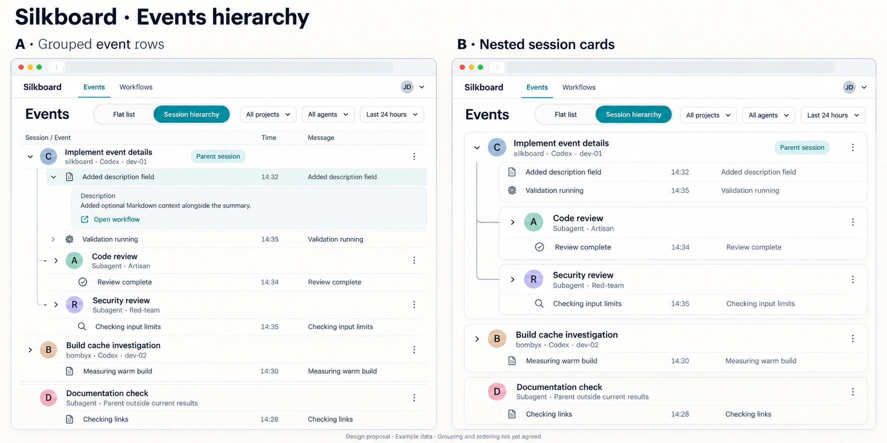
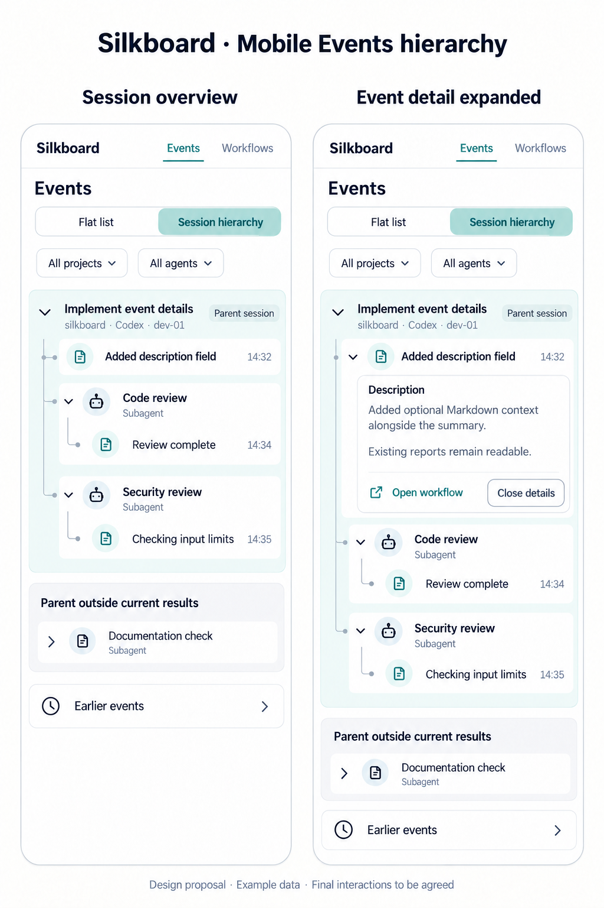

# Events hierarchy proposals

Visual concepts for [issue #109](https://github.com/breki/silkboard/issues/109).
These are generated design proposals with fictional example data, not
screenshots of implemented behavior or agreed final interactions.

## Desktop comparison

A compares compact grouped event rows with B's nested session cards. Both
show a parent session, explicitly nested subagent sessions, an independent
root session and a separate child whose parent is outside the current results.
Group expansion and individual event details are distinct actions.

## Mobile exploration

Shallow nesting keeps session relationships readable on a phone. The detail
state illustrates multi-paragraph descriptions alongside short summaries.

## View selection

Both variants include a **Flat list / Session hierarchy** segmented control
near the Events heading. It preserves a route back to the existing
chronological list. Hierarchy is selected in these illustrations; the default
and preference persistence are not decided. Filters stay separate from the
view switch. Original images without the switch are retained as earlier
proposal assets.

## Generation briefs

Generated with the built-in image-generation tool. Desktop prompt: two
side-by-side light-theme Silkboard dashboards comparing grouped table rows
and nested session cards, with the same parent/subagent example reports,
explicit unavailable-parent treatment, filters and optional event details.
Mobile prompt: two phone panels showing session hierarchy overview and an
expanded event description, shallow tree connectors, separate controls and
an unavailable-parent group. Both prompts request clear proposal labels,
readable text, fictional data and no agent execution controls.

The follow-up edit prompts add only a two-option Flat list / Session hierarchy
control to each panel, select Session hierarchy for illustration, and preserve
all existing relationships and example data. They allow extra vertical space
to keep labels and touch targets readable.

Exact ordering, expand/collapse defaults, pagination/filter behavior and
layout remain design choices in the issue. Images illustrate relationships;
the issue's written acceptance criteria remain authoritative.
