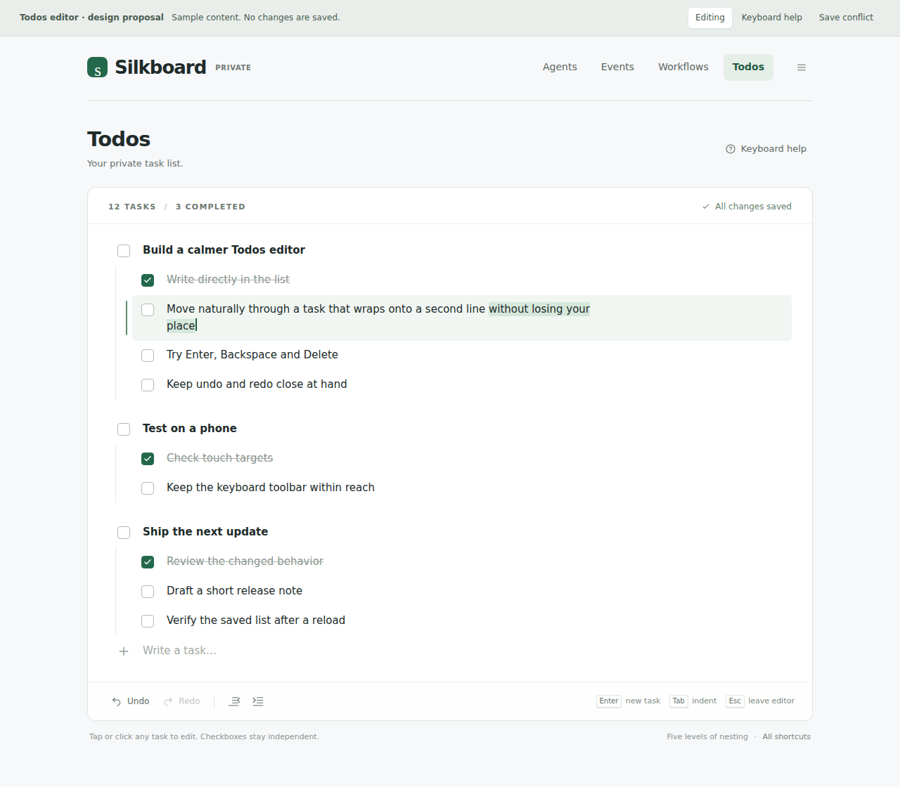
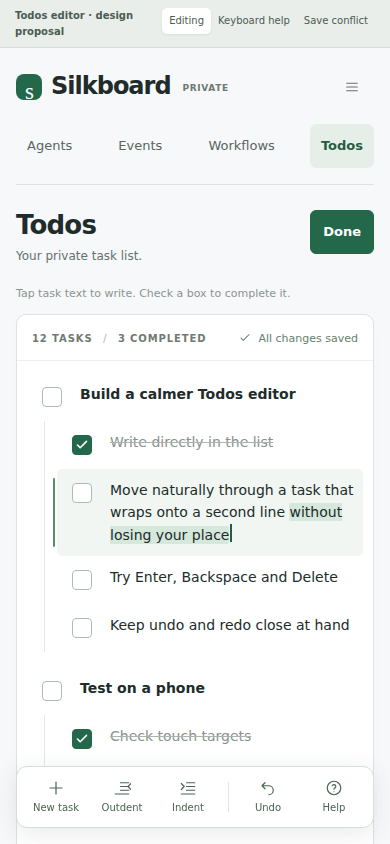
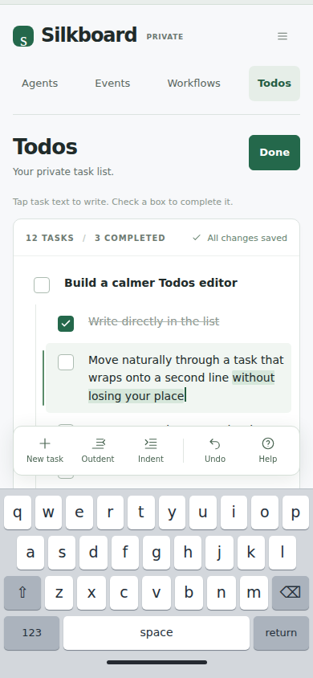
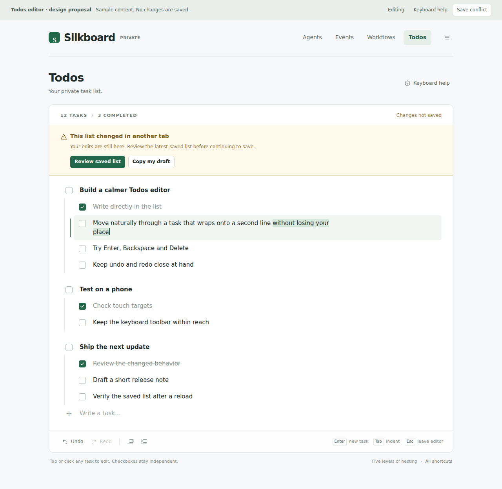
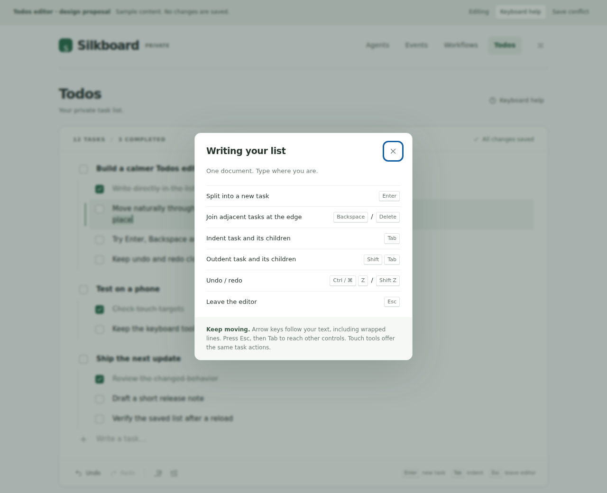

# Todos editor proposal — #124

Visual mockups for [issue #124](https://github.com/breki/silkboard/issues/124).
The application is unchanged. These sample tasks are invented for the proposal.
This is a design for review, not a working task editor or evidence of saving.

## Desktop

One continuous task document, independent checkboxes and a quiet editing toolbar.
The highlighted row illustrates a selection and caret across wrapped text.

## Phone

Visible primary navigation, direct task text, a Done action and large checkbox
targets. Shared touch tools provide New task, Outdent, Indent, Undo and Help.

### With the on-screen keyboard

The editing tools sit above an illustrative keyboard, keeping the selected
task visible. The real keyboard's appearance belongs to the user's device;
the keyboard shown here is a drawing, not an implemented input integration.

## Save conflict

A conflict preserves the visible draft and offers Review saved list and Copy
my draft. The exact recovery interaction remains to be agreed; the mockup's
review button opens an explanatory placeholder, not a merge implementation.

## Keyboard help

Help makes document shortcuts discoverable and explains Esc followed by Tab
for leaving the editor and reaching other controls.

## Confirmed and proposed behavior

The owner confirmed Enter splitting at the caret, boundary Backspace/Delete
joining adjacent tasks, promotion of children when an item is removed, and
undo/redo replacing delete confirmations. The mockups illustrate this direction.

Additional proposals shown here still need review:

- Tab and Shift+Tab move a task's subtree together, within the existing five
  levels. Exact parent-selection and split-child edge cases remain unsettled.
- Automatic saving has visible saved, saving and conflict/error states;
  normal typing keeps its caret and selection. The save cadence, recovery
  details and navigation/expiry behavior are not yet an agreed contract.
- Esc leaves keyboard editing; Done provides the touch equivalent. Entering
  the document and assistive-technology navigation need implementation checks.
- Touch actions live in one shared toolbar rather than on every task.

The displayed Saved status is sample UI text. No network requests or browser
storage are used. Only checkbox/count previews, state switches and the help
and explanatory dialogs work. Text editing, task commands, saving, undo/redo
and production conflict recovery are not implemented. Preview action buttons
say so when clicked. Sample changes reset on reload.

## Open the HTML preview

GitHub renders the images above. To inspect the responsive layout, download
[index.html](index.html) using GitHub's **Download raw file** control and open
it in a browser. No server, installation, login or production access is needed.
Resize the window to switch layouts. The proposal bar switches Editing,
Keyboard help and Save conflict; it is not part of the proposed app UI.

## Local verification

Chromium rendered desktop, phone, phone-with-keyboard, conflict and help views.
The checks found no script errors, external requests or horizontal overflow;
phone checkbox targets are at least 44 by 44 pixels. Checkbox count updates,
help opening and native Escape dismissal were checked. These checks validate
the mockup only; they do not establish the real editor's keyboard, mobile,
accessibility, persistence or recovery behavior.
